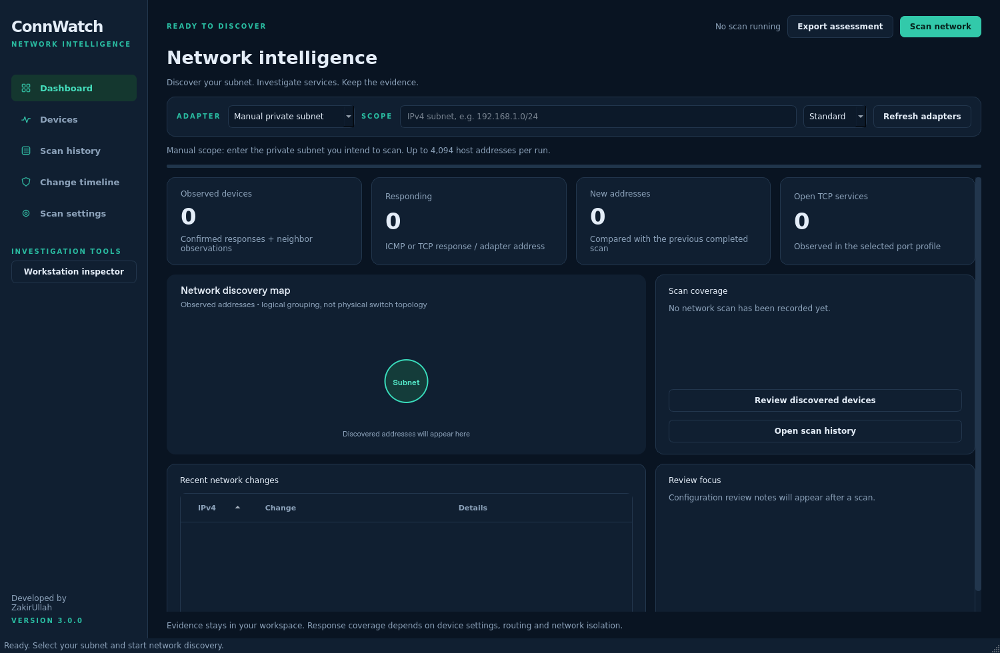

# ConnWatch Network

**Private-subnet discovery, device inventory and network evidence in a native desktop application.**

**Developed by ZakirUllah** · Version 3.0.0 · Windows x64 and Kali/Linux · MIT

ConnWatch helps you understand which addresses respond on your network, which selected TCP services they expose, and what changed between assessments. It detects available private IPv4 adapters and their actual netmasks, records scan evidence in SQLite, and exports reports for review.



## Download and run

**[Download version 3.0.0 from GitHub Releases](https://github.com/HaxorAdmin/project/releases/tag/v3.0.0)**. The release includes a Windows installer, portable Windows package, Kali/Linux source and matching checksums.

| Package | Choose this when | Instructions |
| --- | --- | --- |
| [Windows setup EXE](https://github.com/HaxorAdmin/project/releases/download/v3.0.0/ConnWatch-Network-Setup-3.0.0.exe) | You want an installed application and Start menu/desktop shortcuts | [Windows setup guide](docs/INSTALL-WINDOWS.md) |
| [Windows portable ZIP](https://github.com/HaxorAdmin/project/releases/download/v3.0.0/ConnWatch-Network-Windows-3.0.0.zip) | You want to run from an extracted folder | [Portable setup](docs/INSTALL-WINDOWS.md#portable-edition) |
| [Kali/Linux and complete source ZIP](https://github.com/HaxorAdmin/project/releases/download/v3.0.0/ConnWatch-Network-Source-Kali-3.0.0.zip) | You use Linux or want to inspect and edit the source | [Kali/Linux guide](docs/INSTALL-KALI.md) |
| [SHA-256 checksums](https://github.com/HaxorAdmin/project/releases/download/v3.0.0/SHA256SUMS.txt) | You want to compare downloaded bytes | [Integrity checks](docs/INSTALL-WINDOWS.md#check-download-integrity) |

Open the release page and select the required file under **Assets**. Windows packages include their Python/Qt runtime. The source edition requires Python 3.10+ and a graphical desktop. This is an **unsigned development release**; native Windows acceptance testing remains outstanding. See [validation](docs/VALIDATION.md) and [troubleshooting](docs/TROUBLESHOOTING.md).

## Features

- Detect available private IPv4 addresses, real subnet masks and available default-gateway evidence.
- Discover addresses through ICMP, TCP responses and available ARP/neighbor observations.
- Review IP, available hostname/MAC/manufacturer, selected TCP services and first/last observation.
- Use Discovery, Standard, Extended or Custom TCP profiles with bounded scope and probe pacing.
- Keep scan history, no-response outcomes, checked-port coverage, errors and UTC timestamps.
- Add friendly names, owners, notes and review decisions with an annotation journal.
- Compare completed scans of the same scope for newly observed addresses and evidence changes.
- Schedule repeat scans while the application stays open.
- Export PDF, HTML, CSV and detailed JSON evidence.
- Use dark/light themes, smooth transitions and a reduced-motion option.
- Open the separate workstation inspector for this computer's sockets, processes and host review rules.

## Windows quick start

1. Download and run the setup EXE, then open **ConnWatch Network** from its shortcut.
2. Select the intended Ethernet, Wi-Fi or VPN adapter. Check the displayed IP, subnet and gateway.
3. Start with **Discovery** or **Standard**, then click **Scan network**.
4. Open **Devices** and inspect an address. Add owner/review notes where useful.
5. Scan the same subnet again to review the **Change timeline**, or export a scan from history.

The installer and application do not require a separate Python installation. For portable use, extract the complete ZIP before running `ConnWatch.exe`.

## Kali/Linux quick start

Clone this repository, then open its project folder:

```bash
git clone https://github.com/HaxorAdmin/project.git
cd project
python3 -m venv .venv
.venv/bin/python -m pip install -r requirements.txt
.venv/bin/python main.py
```

For a private repository, authenticate with your own GitHub account using your normal Git credential setup. Alternatively download **Code → Download ZIP** while signed in, extract it and open a terminal in the folder containing `main.py`.

The release source ZIP contains a `ConnWatch-Network` folder. Enter that folder and run the same Python commands. Later launches need only `.venv/bin/python main.py`. See the [complete Kali guide](docs/INSTALL-KALI.md), including VM networking and dependency help.

## Understand the results

**Responding** means this scan received direct response evidence. **Neighbor observed** means neighbor/MAC evidence was available, which may be cached. **No response** means the selected checks did not receive evidence; it does not prove a device is absent or offline.

Only scan networks you own or have permission to assess. Scope is limited to RFC1918 private IPv4 ranges, with at most 4,094 host addresses per run. Firewalls, client isolation, routing and sleeping devices affect visibility. The map groups observations logically; it does not discover physical switch wiring. Port findings are review hints, not confirmed vulnerabilities. This version does not perform exhaustive UDP or IPv6 enumeration, collect credentials or decrypt other devices' traffic.

## Documentation

| Guide | Contents |
| --- | --- |
| [Windows installation](docs/INSTALL-WINDOWS.md) | Setup, portable use, source launch and integrity checks |
| [Kali/Linux installation](docs/INSTALL-KALI.md) | Dependencies, first launch, repeat launch and VM networking |
| [Detailed usage](docs/USAGE.md) | Profiles, evidence meanings, retention, scheduling and exports |
| [Architecture](docs/ARCHITECTURE.md) | Languages, modules, storage and execution flow |
| [Troubleshooting](docs/TROUBLESHOOTING.md) | Startup, workspace locks, Qt and network visibility |
| [Build instructions](docs/BUILD.md) | Reproduce Windows packaging from source |
| [Validation](docs/VALIDATION.md) | Executed checks and platform limitations |
| [Acceptance checklist](docs/ACCEPTANCE-CHECKLIST.md) | Manual checks on the target Windows system |
| [Changelog](CHANGELOG.md) | Version 3.0 changes |

## Development and verification

Install `requirements.txt` in a virtual environment. Tests use controlled fixtures and owned loopback sockets; they do not assess the user's LAN.

```bash
QT_QPA_PLATFORM=offscreen .venv/bin/python -m unittest discover -s tests -v
QT_QPA_PLATFORM=offscreen .venv/bin/python main.py --data-dir /tmp/connwatch-check --self-check
```

On Windows CMD, set `QT_QPA_PLATFORM=offscreen` first and use `.venv\Scripts\python.exe` with the same arguments. The self-check initializes the window/database and exits without sending scan probes. Linux verification for this publication is recorded in [publication checks](docs/PUBLICATION-CHECKS.md). The [Windows packaging workflow](.github/workflows/windows-release.yml) also completed successfully and published the unsigned release; it cross-compiles Windows packages and does not establish native Windows acceptance. A passing Linux suite does not establish native Windows acceptance.

## Data and licensing

Scan records stay in the selected per-user workspace. Default Windows location: `%LOCALAPPDATA%\ZakirUllah\ConnWatchDesktop`; Linux: `~/.local/share/ZakirUllah/ConnWatchDesktop`. Reports may contain private device names and addresses. Review reports before sharing. Generated databases, settings and user logs are excluded from this repository.

Application source is licensed under [MIT](LICENSE). Third-party Python, Qt, Go and manufacturer-data notices are retained in [licenses](licenses). The offline manufacturer registry attribution is also recorded in `assets/vendor-source.json`.

**Developed by ZakirUllah** · [GitHub: HaxorAdmin](https://github.com/HaxorAdmin)
